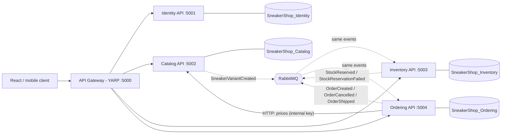

# Sneaker Shop - .NET 8 Microservices Backend

An e-commerce backend for a sneaker seller, built with **.NET 8**, **ASP.NET Core Web API**, **EF Core + SQL Server**,
**RabbitMQ (MassTransit)**, **YARP** API gateway and **Docker Compose**.

## Architecture



| Service | Responsibility | Database |
|---|---|---|
| **ApiGateway** | Single public entry point, routing, per-IP rate limit, CORS | - |
| **Identity.Api** | Register/login, BCrypt password hashing, issues JWT (roles: Admin, Customer) | `SneakerShop_Identity` |
| **Catalog.Api** | Brands, sneakers, size/color variants, search and filters | `SneakerShop_Catalog` |
| **Inventory.Api** | Stock per variant, reservations, low-stock view | `SneakerShop_Inventory` |
| **Ordering.Api** | Orders and their lifecycle; reads real prices from Catalog | `SneakerShop_Ordering` |
| **SneakerShop.BuildingBlocks** | Shared library: event contracts, JWT setup, error handling, seed data | - |

Each service is a small layered app: **Controllers -> Services -> DbContext/Domain**.

## Run it

Requirements: Docker Desktop. (For `dotnet run` you also need the .NET 8 SDK, SQL Server and RabbitMQ.)

```bash
docker compose up --build
```

- Gateway: <http://localhost:5000> (use this from your frontend)
- Per-service Swagger UI (development only): <http://localhost:5001/swagger> (Identity), `:5002` Catalog, `:5003` Inventory, `:5004` Ordering
- RabbitMQ management: <http://localhost:15672> (guest / guest)
- SQL Server: `localhost,1433`, user `sa`, password `Sneaker_Shop123` (override with `SA_PASSWORD`)

Demo accounts (created on first start; **change them outside local development**):

| Role | Email | Password |
|---|---|---|
| Admin | admin@sneakershop.local | Admin@12345 |
| Customer | customer@sneakershop.local | Customer@12345 |

Try the full flow with [`docs/requests.http`](docs/requests.http).

### Without Docker

Start SQL Server and RabbitMQ yourself, then in five terminals:

```bash
dotnet run --project src/Services/Identity/Identity.Api     # :5001
dotnet run --project src/Services/Catalog/Catalog.Api       # :5002
dotnet run --project src/Services/Inventory/Inventory.Api   # :5003
dotnet run --project src/Services/Ordering/Ordering.Api     # :5004
dotnet run --project src/Gateway/ApiGateway                 # :5000
```

## Public API (through the gateway)

| Method | Path | Access | Description |
|---|---|---|---|
| POST | `/api/auth/register` | public | Create a customer account |
| POST | `/api/auth/login` | public | Get a JWT |
| GET | `/api/auth/me` | user | Current profile |
| GET | `/api/brands` | public | List brands |
| POST | `/api/brands` | admin | Create brand |
| GET | `/api/sneakers` | public | Search/filter/sort/page (`search, brandId, gender, minPrice, maxPrice, sort, page, pageSize`) |
| GET | `/api/sneakers/{id}` | public | Detail with variants |
| POST / PUT / DELETE | `/api/sneakers[/{id}]` | admin | Create / update / soft-delete |
| POST | `/api/sneakers/{id}/variants` | admin | Add size/color (creates stock record via event) |
| GET | `/api/inventory/{variantId}/availability` | public | Pairs available |
| POST | `/api/inventory/availability` | public | Availability for many variants |
| GET | `/api/inventory` | admin | Stock list, `maxAvailable` for low stock |
| PUT | `/api/inventory/{variantId}` | admin | Set quantity on hand |
| POST | `/api/orders` | user | Place an order (requires `Idempotency-Key`) |
| GET | `/api/orders/my` | user | My orders |
| GET | `/api/orders/{id}` | owner/admin | One order |
| POST | `/api/orders/{id}/cancel` | owner/admin | Cancel (Pending or Confirmed) |
| GET | `/api/orders` | admin | All orders, filter by `status` |
| PUT | `/api/orders/{id}/status` | admin | `Shipped` or `Delivered` |

## How an order flows (Order state machine)

1. `POST /api/orders` requires a unique `Idempotency-Key`. Ordering reads authoritative prices from Catalog and saves the **Pending** order and `OrderCreated` in the same SQL transaction using MassTransit's EF bus outbox.
2. Inventory reserves stock for all lines (all-or-nothing) and publishes `StockReserved` or `StockReservationFailed`; MassTransit's EF consumer outbox makes the reservation and reply recoverable together.
3. Ordering's persisted MassTransit state machine moves the order to **Confirmed** or **Rejected**. If no reservation response arrives within two minutes, it cancels the order and publishes compensation.
4. A reservation expires after 15 minutes unless Inventory receives `OrderPaid` (published by the payment integration in response to `OrderPaymentReceived`). Expiration releases stock and cancels the order. Shipping requires a paid order; cancel releases stock and ship commits it.

Order state machine: `Pending -> Confirmed -> Shipped -> Delivered`, with `Pending -> Rejected` and `Pending/Confirmed -> Cancelled`.

Failed MassTransit deliveries retry with exponential backoff. Messages that exhaust retries are retained in RabbitMQ's `<endpoint>_error` queues; `Fault<T>` events are consumed and logged for operational visibility.

## Database migrations and tests

All service databases are initialized with EF Core migrations. Existing databases created by the previous `EnsureCreated` version are detected and baselined automatically, then upgraded with additive migrations while retaining existing data. Back up production databases before deploying schema changes.

Run the Ordering state-machine and integration tests with:

```powershell
dotnet test src/Services/Ordering/Ordering.Api/test/Ordering.Api.Tests/Ordering.Api.Tests.csproj
```

The integration tests use Testcontainers and require Docker.

## Design decisions

- **Database per service** - no cross-database foreign keys; services share only IDs and events.
- **Prices are snapshotted** into `OrderItems`, so catalog changes never alter past orders.
- **Optimistic concurrency** (`RowVersion`) on stock and orders; MassTransit retries with exponential backoff.
- **Idempotent consumers** - a redelivered event does not reserve or release stock twice.
- **Internal endpoint** `/internal/variants/lookup` is protected by a shared key and is not routed by the gateway.
- **JWT** is validated by every service with the same key; roles are checked with `[Authorize(Roles = ...)]`.
- Errors are returned as RFC 7807 `ProblemDetails`.

## Before going to production

- Move secrets (`Jwt:Key`, `Internal:ApiKey`, SQL password, demo accounts) to a secret store; use HTTPS.
- Add a Payment service, email notifications, and structured tracing (OpenTelemetry).
- Only expose the gateway; do not publish the per-service ports.
