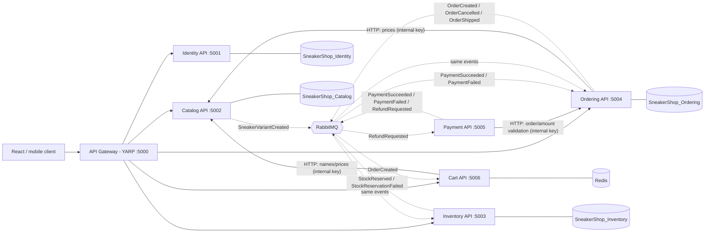

# Sneaker Shop - .NET 8 Microservices Backend

An e-commerce backend for a sneaker seller, built with **.NET 8**, **ASP.NET Core Web API**, **EF Core + SQL Server**,
**RabbitMQ (MassTransit)**, **Redis (FusionCache)**, **YARP** API gateway and **Docker Compose**.

## Architecture



| Service | Responsibility | Database |
|---|---|---|
| **ApiGateway** | Single public entry point, routing, per-IP rate limit, CORS | - |
| **Identity.Api** | Register/login, BCrypt password hashing, issues JWT (roles: Admin, Customer) | `SneakerShop_Identity` |
| **Catalog.Api** | Brands, sneakers, size/color variants, search and filters | `SneakerShop_Catalog` |
| **Inventory.Api** | Stock per variant, reservations, low-stock view | `SneakerShop_Inventory` |
| **Ordering.Api** | Orders and their lifecycle; reads real prices from Catalog | `SneakerShop_Ordering` |
| **Payment.Api** | Payment attempts, VNPay IPN verification, reconciliation and refunds | `SneakerShop_Payment` |
| **Cart.Api** | Shopping cart per customer; ordered lines are removed on `OrderCreated` | Redis |
| **SneakerShop.BuildingBlocks** | Shared library: event contracts, JWT setup, error handling, seed data | - |

Each service is a small layered app: **Controllers -> Services -> DbContext/Domain**.

## Run it

Requirements: Docker Desktop. (For `dotnet run` you also need the .NET 8 SDK, SQL Server and RabbitMQ.)

```bash
docker compose up --build
```

- Gateway: <http://localhost:5000> (use this from your frontend)
- Per-service Swagger UI (development only): <http://localhost:5001/swagger> (Identity), `:5002` Catalog, `:5003` Inventory, `:5004` Ordering, `:5005` Payment, `:5006` Cart
- RabbitMQ management: <http://localhost:15672> (guest / guest)
- Redis: `localhost:6379`
- SQL Server: `localhost,1433`, user `sa`, password `12345` (local development only; override with `SA_PASSWORD`)

Demo accounts (created on first start; **change them outside local development**):

| Role | Email | Password |
|---|---|---|
| Admin | admin@sneakershop.local | Admin@12345 |
| Customer | customer@sneakershop.local | Customer@12345 |

Try the full flow with [`docs/requests.http`](docs/requests.http).
Payment endpoints are documented in [`Payment.Api/docs/README.md`](src/Services/Payments/Payment.Api/docs/README.md).

### Without Docker

Start SQL Server, RabbitMQ and Redis yourself, then in seven terminals:

```bash
dotnet run --project src/Services/Identity/Identity.Api     # :5001
dotnet run --project src/Services/Catalog/Catalog.Api       # :5002
dotnet run --project src/Services/Inventory/Inventory.Api   # :5003
dotnet run --project src/Services/Ordering/Ordering.Api     # :5004
dotnet run --project src/Services/Payments/Payment.Api     # :5005
dotnet run --project src/Services/Cart/Cart.Api             # :5006
dotnet run --project src/Gateway/ApiGateway                 # :5000
```

## Public API (through the gateway)

| Method | Path | Access | Description |
|---|---|---|---|
| POST | `/api/auth/register` | public | Create a customer account |
| POST | `/api/auth/login` | public | Get a JWT |
| POST | `/api/auth/logout` | user | Revoke the current token in every service |
| GET | `/api/auth/me` | user | Current profile |
| GET | `/api/brands` | public | List brands |
| POST | `/api/brands` | admin | Create brand |
| GET | `/api/sneakers` | public | Search/filter/sort/page (`search, brandId, gender, minPrice, maxPrice, sort, page, pageSize`) |
| GET | `/api/sneakers/{id}` | public | Detail with variants |
| GET | `/api/sneakers/best-sellers` | public | Most pairs shipped in the last `days` (1-30) |
| POST / PUT / DELETE | `/api/sneakers[/{id}]` | admin | Create / update / soft-delete |
| POST | `/api/sneakers/variants` | admin | Add one `color` to every active sneaker; returns each sneaker's variant ids (stock records via event) |
| POST | `/api/sneakers/{id}/variants` | admin | Add size/color (creates stock record via event) |
| GET | `/api/inventory/{variantId}/availability` | public | Pairs available |
| POST | `/api/inventory/availability` | public | Availability for many variants |
| GET | `/api/inventory` | admin | Stock list, `maxAvailable` for low stock |
| PUT | `/api/inventory/{variantId}` | admin | Set quantity on hand |
| POST | `/api/orders` | user | Place an order (requires `Idempotency-Key`) |
| GET | `/api/orders/my` | user | My orders |
| GET | `/api/orders/{id}` | owner/admin | One order |
| POST | `/api/orders/{id}/cancel` | owner/admin | Cancel (Pending or Confirmed; a paid order also requests refund) |
| GET | `/api/orders` | admin | All orders, filter by `status` |
| PUT | `/api/orders/{id}/status` | admin | `Shipped` or `Delivered` |
| GET | `/api/flash-sales/{variantId}` | public | Pairs left in a running flash sale |
| PUT / DELETE | `/api/flash-sales/{variantId}` | admin | Start (`quantity`, `endsAt`) / end a flash sale |
| GET / DELETE | `/api/cart` | user | My cart (with current prices) / empty it |
| PUT / DELETE | `/api/cart/items/{variantId}` | user | Set quantity (1-10) / remove one line |
| POST | `/api/payments` | user | Start/retry payment (`orderId`, `method`: `VnPay` or `Fake`) |
| GET | `/api/payments/{id}` | owner/admin | Current payment and latest attempt |
| GET | `/api/payments/webhooks/vnpay` | provider | Public VNPay IPN (60 requests/minute per IP) |
| GET | `/api/payments/vnpay/return` | public | VNPay sandbox browser return (verifies, then redirects) |
| POST | `/api/payments/{id}/refund` | admin | Request full/partial refund (`Idempotency-Key` must be a GUID) |

## How an order flows (Order state machine)

1. `POST /api/orders` requires a unique `Idempotency-Key`. Ordering reads authoritative prices from Catalog and saves the **Pending** order and `OrderCreated` in the same SQL transaction using MassTransit's EF bus outbox.
2. Inventory reserves stock for all lines (all-or-nothing) and publishes `StockReserved` or `StockReservationFailed`; MassTransit's EF consumer outbox makes the reservation and reply recoverable together.
3. Ordering's persisted MassTransit state machine moves the order to **Confirmed** or **Rejected**. If no reservation response arrives within two minutes, it cancels the order and publishes compensation.
4. A confirmed order can be paid with `POST /api/payments` (`orderId` + `method`). `method: vnpay` creates a signed VNPay sandbox URL. The signed IPN and browser return (`/api/payments/vnpay/return`) both confirm the payment.
5. Ordering marks a valid payment paid, moves the order to **Shipped**, and publishes `OrderPaid` plus `OrderShipped`. Inventory reservation and payment use the same `PaymentExpiresAt` timestamp (15 minutes after order creation). A late successful payment after cancellation is automatically refunded.

Order state machine: `Pending -> Confirmed -> Shipped -> Delivered`, with `Pending -> Rejected` and `Pending/Confirmed/Paid -> Cancelled`.

Local development can use `Fake` plus `POST /api/payments/dev/attempts/{id}/succeed`, or `vnpay` with the bundled VNPay sandbox sample merchant. Override `VNPAY_TMN_CODE` and `VNPAY_HASH_SECRET` if you registered your own sandbox website. Open the returned `paymentUrl` on the VNPay sandbox; after paying, VNPay redirects to `/api/payments/vnpay/return`, which verifies the signature and then sends the browser to `http://localhost:5173/payment/result`. Configure the merchant IPN URL to `/api/payments/webhooks/vnpay` and expose the gateway (ngrok or Cloudflare Tunnel) if you want server-to-server confirmation as well.

Failed MassTransit deliveries retry with exponential backoff. Messages that exhaust retries are retained in RabbitMQ's `<endpoint>_error` queues; `Fault<T>` events are consumed and logged for operational visibility.

## Database migrations and tests

All service databases are initialized with EF Core migrations. Existing databases created by the previous `EnsureCreated` version are detected and baselined automatically, then upgraded with additive migrations while retaining existing data. Back up production databases before deploying schema changes.

Run the Ordering state-machine and integration tests with:

```powershell
dotnet test src/Services/Ordering/Ordering.Api/test/Ordering.Api.Tests/Ordering.Api.Tests.csproj
```

The integration tests use Testcontainers and require Docker.

Run the Payment unit tests (no external services required) with:

```powershell
dotnet test src/Services/Payments/Payment.Api/test/Payment.Api.Tests/Payment.Api.Tests.csproj
```

## Design decisions

- **Database per service** - no cross-database foreign keys; services share only IDs and events.
- **Prices are snapshotted** into `OrderItems`, so catalog changes never alter past orders.
- **Optimistic concurrency** (`RowVersion`) on stock and orders; MassTransit retries with exponential backoff.
- **Idempotent consumers** - a redelivered event does not reserve or release stock twice.
- **Internal endpoints** are protected by a shared key and are not routed by the gateway.
- **JWT** is validated by every service with the same key; roles are checked with `[Authorize(Roles = ...)]`.
- Errors are returned as RFC 7807 `ProblemDetails`.

## Redis

| Use | Where | How |
|---|---|---|
| Read cache | Catalog (brands, lists, details), Inventory (availability) | FusionCache: memory + Redis, Redis pub/sub backplane |
| Cart storage | Cart.Api | Hash `cart:v1:{userId}`, 30-day TTL refreshed on change |
| Token revocation | Identity writes, every service checks | `auth:v1:revoked:{jti}` until the token expires |
| Login limit | Identity | `INCR` + TTL per email (5 failures / 15 minutes) |
| Rate limit | Gateway | Fixed windows shared by all replicas |
| Flash-sale gate | Ordering | Per-variant counter, decremented atomically by a Lua script |
| Best sellers | Catalog | One sorted set per day, `ZUNION` over the window |

Rules the code follows:

- **Cache is never the source of truth for buying.** Order prices come from Catalog's uncached internal endpoint, and stock is reserved against the database. The flash-sale counter only turns excess requests away early; Inventory still decides.
- **Every key has a TTL.** FusionCache always applies a duration, and every raw Redis write sets an expiry (in the same Lua script or transaction when it is a counter). Redis runs with `volatile-ttl`, so short-lived cache entries are evicted before carts.
- **Versioned keys.** Each service's cache keys start with `v1`. Bump the version in `CatalogCacheKeys` / `InventoryCacheKeys` (or the store class) whenever a cached object changes shape.
- **Invalidation across instances.** Writes remove entries after the database commit; the backplane removes the in-memory copy on every other instance.
- **Redis down.** Reads fall back to the database, the gateway falls back to per-replica limits, and the revocation check and login limit are skipped. Cart, logout and flash-sale admin return `503`.

## Before going to production

- Move secrets (`Jwt:Key`, `Internal:ApiKey`, SQL password, demo accounts) to a secret store; use HTTPS.
- Move VNPay keys to a secret store, configure provider IP allowlists at the edge, and add structured tracing (OpenTelemetry).
- Only expose the gateway; do not publish the per-service ports.
- Give carts their own Redis (persistence on, `noeviction`) separate from the cache Redis, and enable Redis auth/TLS.
