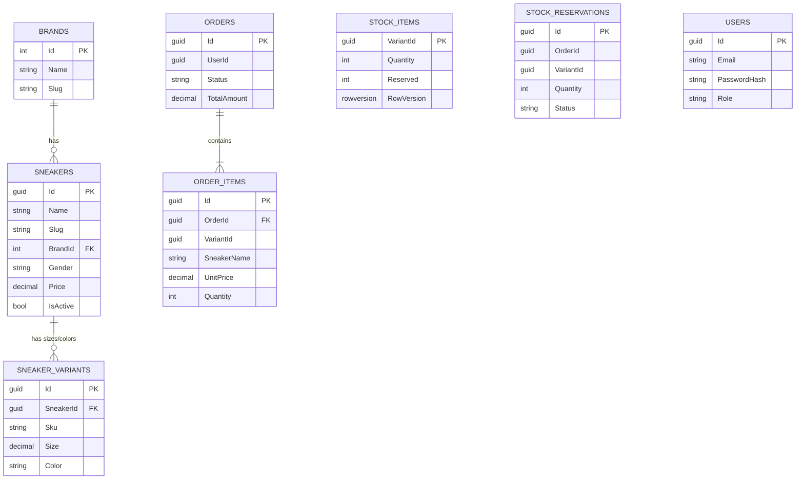

# Database scripts

Each microservice owns its own database (**database-per-service**). No SQL foreign keys cross databases:
services only share IDs (e.g. `VariantId`) and talk through HTTP and events.

You do **not** need these scripts to run the project: every service creates its own schema and seed data
on first start (`EnsureCreated`). Use the scripts if you prefer to create the databases yourself
or want to inspect the schema.

## Run order

| # | Script | Purpose |
|---|--------|---------|
| 0 | `00-create-databases.sql` | Creates the 4 databases |
| 1 | `01-identity-schema.sql` | Users |
| 2 | `02-catalog-schema.sql` | Brands, Sneakers, SneakerVariants |
| 3 | `03-catalog-seed.sql` | 4 brands, 6 sneakers, 24 variants |
| 4 | `04-inventory-schema.sql` | StockItems, StockReservations |
| 5 | `05-inventory-seed.sql` | 20 pairs per seeded variant |
| 6 | `06-ordering-schema.sql` | Orders, OrderItems |

```bash
sqlcmd -C -S localhost,1433 -U sa -P "Sneaker_Shop123" -i 00-create-databases.sql
# ...then the remaining files in order
```

The demo users are created by the Identity service on first start because their passwords must be hashed with BCrypt.
If you create the schema with these scripts, the services detect existing tables and only add seed data when a table is empty.

## Entity relationships



Logical (not enforced) links across databases: `STOCK_ITEMS.VariantId` = `SNEAKER_VARIANTS.Id`,
`ORDER_ITEMS.VariantId` = `SNEAKER_VARIANTS.Id`, `ORDERS.UserId` = `USERS.Id`.
